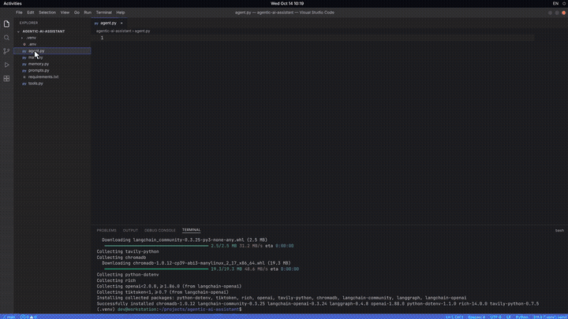

# Agentic AI — Developer Timelapse Video Generator

A 62-second, 4K, screen-recording-style video of a developer building an **Agentic AI system** from scratch:
VS Code setup, writing the agent's "brain", wiring a LangGraph-style workflow, testing it on a real task,
a live dashboard, and finally multimodal image + video generation.

**Every pixel is generated by code.** No screen recorder, no AI video model and no stock footage were used.
The whole video is one HTML page animated by JavaScript and captured frame-by-frame with a headless browser.



▶ Full video: [`docs/demo-1080p.mp4`](docs/demo-1080p.mp4)

---

## What's in this repo

This repo contains two projects:

| | Folder | What it is |
|---|---|---|
| **A** | `src/` + `scripts/` | **The video generator.** The HTML/CSS/JS "scene engine" plus Python scripts that render it to MP4. |
| **B** | `agent-example/` | **The agent shown in the video, runnable for real.** The same `agent.py`, `prompts.py` and `tools.py` the developer types on screen, plus `memory.py` and `main.py` to make it work. |

```
agentic-ai-video-generator/
├── src/                      ← the video itself (open index.html in a browser)
│   ├── index.html            ← all UI mock-ups (VS Code, terminal, graph studio, chat, dashboard, studio) + CSS
│   ├── app.js                ← timeline engine: seek(t), camera, cursor, scenes 1–5
│   ├── gen.js                ← scene 6: prompt → image generation → video generation
│   ├── code.js               ← the Python source code that gets "typed" on screen
│   ├── player.js             ← live preview player (index.html?play)
│   └── fonts/                ← JetBrains Mono + Inter (bundled so output is identical everywhere)
├── scripts/
│   ├── check_setup.py        ← verifies Python, Playwright/Chromium, ffmpeg
│   ├── preview.py            ← saves still images at chosen seconds (fast, use while editing)
│   └── render.py             ← renders every frame and encodes the MP4 (1080p or 4K)
├── agent-example/            ← the working agent (see agent-example/README.md)
├── docs/
│   ├── HOW_IT_WORKS.md       ← deep-dive: architecture, timeline, and how to add your own scene
│   ├── screenshots/          ← one still per scene
│   ├── demo.gif, demo-1080p.mp4
├── output/                   ← rendered videos land here (git-ignored)
├── requirements.txt
└── LICENSE
```

---

## Part A: Build the video yourself

### 1. Requirements

| Tool | Version | Why |
|---|---|---|
| Python | 3.9 or newer | runs the render scripts |
| Playwright + Chromium | installed below | headless browser that draws each frame |
| ffmpeg | any recent | joins the frames into an MP4. **Optional:** if it's missing, the `imageio-ffmpeg` package supplies one automatically. |

No Node.js is needed. The fonts are already bundled.

### 2. Install (one time)

**Windows (PowerShell)**
```powershell
git clone https://github.com/<your-username>/agentic-ai-video-generator.git
cd agentic-ai-video-generator
python -m venv .venv
.venv\Scripts\activate
pip install -r requirements.txt
python -m playwright install chromium
python scripts/check_setup.py
```

**macOS / Linux**
```bash
git clone https://github.com/<your-username>/agentic-ai-video-generator.git
cd agentic-ai-video-generator
python3 -m venv .venv
source .venv/bin/activate
pip install -r requirements.txt
python -m playwright install chromium        # Linux may also need: python -m playwright install-deps chromium
python scripts/check_setup.py
```

`check_setup.py` should print three ✓ lines.

### 3. Watch it live (no rendering)

Open `src/index.html` in Chrome, Edge or Firefox with `?play` added to the address:

```
file:///C:/path/to/agentic-ai-video-generator/src/index.html?play
```

| URL | What happens |
|---|---|
| `index.html?play` | plays the whole video in real time, scaled to your window |
| `index.html?play&from=22` | starts playing at 22 s |
| `index.html?t=30` | freezes on the exact frame at 30 s |

While playing: **Space** pauses, **← / →** jump 2 s, **Home** restarts, and **L** toggles looping.

> Tip: VS Code's "Live Server" extension or `python -m http.server` in `src/` also works if your browser blocks local files.

### 4. Save still images (quick check while editing)

```bash
python scripts/preview.py              # one still per scene → output/stills/
python scripts/preview.py 12 30.5 59   # specific seconds
```

### 5. Render the MP4

```bash
python scripts/render.py                          # 1920×1080, 30 fps → output/agentic-ai-video-1080p.mp4
python scripts/render.py --quality 4k             # 3840×2160         → output/agentic-ai-video-4k.mp4
python scripts/render.py --start 22 --end 33      # render only one scene (great for testing)
python scripts/render.py --workers 4              # more parallel browsers = faster (uses more RAM)
```

| Option | Default | Meaning |
|---|---|---|
| `--quality` | `1080p` | `1080p` or `4k` (same layout, 2× pixel density) |
| `--fps` | `30` | frames per second |
| `--start / --end` | `0 / 62` | time range in seconds |
| `--workers` | CPU count (max 4) | parallel Chromium processes |
| `--crf` | 18 (1080p) / 20 (4k) | x264 quality; lower means better quality and a bigger file |
| `--keep-frames` | off | keep the JPEG frames in `output/frames/` |
| `--encode-only` | off | re-encode frames you already rendered |
| `--out` | `output/…mp4` | output path |

**Typical render times** for the full 62 s (1,860 frames) on a 4-core laptop: 1080p takes about 2–4 minutes and 4K about 5–8 minutes.

---

## How it works (short version)

1. **One page, many fake apps.** `src/index.html` contains hand-built mock-ups of VS Code, a terminal, a graph editor, a chat app, a dashboard and a generation studio, all plain HTML and CSS.
2. **Time is the only input.** `app.js` exposes `seek(t)`. Given a time in seconds, it sets every element to how it should look at that moment: how many characters are typed, where the mouse is, which node glows, the camera zoom, and so on. Nothing uses timers, so any frame can be drawn instantly and in any order.
3. **Capture.** `render.py` opens the page in headless Chromium, and for each frame calls `seek(i / 30)` and takes a screenshot. That is about 1,860 screenshots for 62 seconds.
4. **Encode.** ffmpeg joins the screenshots into an H.264 MP4.

Because frames depend only on `t`, a slow 4K screenshot can never cause a stutter. This is the same idea video editors call *deterministic rendering*.

➡ The full explanation, with a scene-by-scene timeline and a step-by-step "add your own scene" tutorial, is in **[docs/HOW_IT_WORKS.md](docs/HOW_IT_WORKS.md)**.

### Scene timeline

| Time | Scene | Where in the code |
|---|---|---|
| 0–11 s | Setting up: VS Code, terminal, venv, `pip install`, first code | `renderVSCode`, `TERM1` in `app.js` |
| 11–22 s | Building the brain: prompts, tools, reasoning and decision logic | `FILES` in `app.js`, `code.js` |
| 22–33 s | Connecting the workflow: drag nodes, draw edges, run | `renderGraph`, `NODES`, `EDGES`, `PULSES` |
| 33–46 s | Testing: terminal logs + chat with the competitor report | `renderTest`, `TERM2` |
| 46–53 s | Dashboard: new task, autonomous plan, tools, output | `renderDash`, `DSTEPS` |
| 53–57 s | Completed workflow glowing | `renderGraph` (final mode) |
| 57–62 s | Multimodal: prompt, then image and video generation | `gen.js` |

### Common customisations

| I want to… | Edit |
|---|---|
| Change the code typed in the editor | the strings in `src/code.js` |
| Change typing speed or when files open | `FILES`, `OPEN`, `ACTIVE` in `src/app.js` |
| Change the chat prompt or report | `CPROMPT` and the report HTML in `renderTest` |
| Change the dashboard task or steps | `DPROMPT`, `DSTEPS`, `DOUT` |
| Change the final multimodal prompt | `GPROMPT` in `src/gen.js` |
| Move the camera / zoom | the `CAM` keyframes |
| Move the mouse / add clicks | the `CUR` keyframes (`c: 1` = click ripple) |
| Change colours / fonts / layout | CSS in `src/index.html` |
| Change total length | `DUR` in `app.js` (the render script reads it automatically) |

---

## Part B: Run the real agent

The `agent-example/` folder is a working LangGraph agent with an LLM, tools (web search, memory, report writer), long-term vector memory, a reasoning loop, a terminal UI and a web playground.

```bash
cd agent-example
python -m venv .venv && source .venv/bin/activate     # Windows: .venv\Scripts\activate
pip install -r requirements.txt
python test_offline.py                                 # works with NO API keys
cp .env.example .env                                   # then add your OPENAI_API_KEY and TAVILY_API_KEY
python main.py "Research three competitors and create a summary report."
python main.py --serve                                 # web playground → http://127.0.0.1:8000
```

Full guide: **[agent-example/README.md](agent-example/README.md)**

---

## Upload this repo to GitHub

**Option 1: website (no git needed)**
1. On github.com click **New repository**, name it `agentic-ai-video-generator`, and click **Create**.
2. Click **uploading an existing file**, unzip this project, and drag in **all files and folders**.
3. Click **Commit changes**.

**Option 2: command line**
```bash
cd agentic-ai-video-generator
git init
git add .
git commit -m "Agentic AI video generator + runnable agent example"
git branch -M main
git remote add origin https://github.com/<your-username>/agentic-ai-video-generator.git
git push -u origin main
```

---

## Troubleshooting

| Problem | Fix |
|---|---|
| `Executable doesn't exist … chromium` | run `python -m playwright install chromium` |
| Linux: Chromium fails to launch (missing libraries) | `python -m playwright install-deps chromium` |
| `ffmpeg not found` | install ffmpeg (`winget install ffmpeg` / `brew install ffmpeg` / `sudo apt install ffmpeg`) or `pip install imageio-ffmpeg` |
| Fonts look different in the browser | open via a local server (`cd src && python -m http.server`), since some browsers block `file://` fonts |
| Render is slow or the PC runs out of memory | lower `--workers`, or render at `1080p` |
| Blank or black frames | run `python scripts/preview.py`; it prints any JavaScript errors |
| Video won't play in some players | the script already uses `yuv420p` + `faststart`; try VLC to confirm |

---

## Notes

- All interfaces are **original mock-ups** built for teaching. They resemble common developer tools but are not screenshots of, or affiliated with, VS Code, LangGraph, or any other product. Names are used only to describe what the mock-ups represent.
- Companies in the demo report (Nimbus AI, Coreline, Parallax Labs) and all metrics are **fictional**.
- The poster and video artwork in the final scene are drawn in SVG by `gen.js`. No image model was called.

## License

Code: [MIT](LICENSE). Fonts in `src/fonts/` are under the SIL Open Font License 1.1 (see the license files in that folder).
